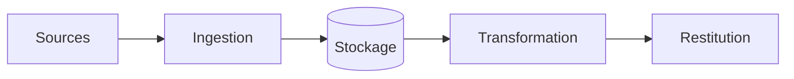

# Nom du projet


Une phrase : quel problème, pour qui, avec quelles données.

## Résultat

Le chiffre ou la capture qui montre que ça marche (à remplir à la fin).

## Architecture



## Lancer le projet

```bash
make install
make check
```

## Décisions

Les choix importants et leur raison sont dans `docs/decisions.md`.

## Limites

Ce que le projet ne fait pas, et pourquoi.
